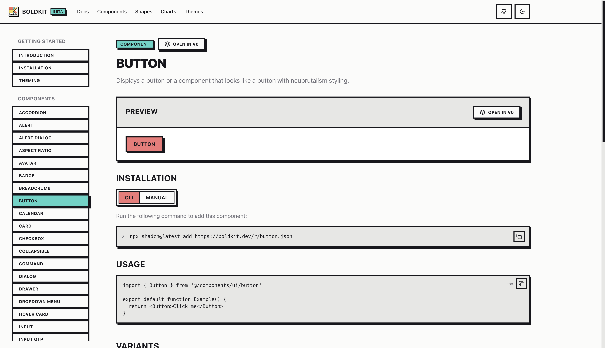
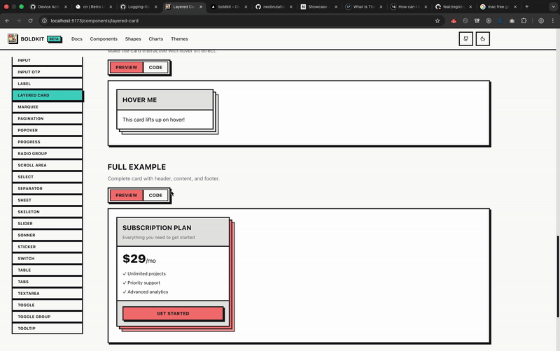
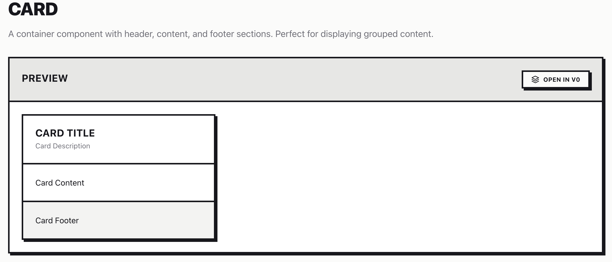

# BoldKit

<div align="center">


**Bold. Raw. Beautiful.**

A neubrutalism component library for React and Vue 3, built on shadcn/ui.

[](https://github.com/ANIBIT14/boldkit/releases/tag/v3.6.1)
[](LICENSE)
[](https://react.dev)
[](https://vuejs.org)
[](https://nuxt.com)
[](https://tailwindcss.com)
[](https://typescriptlang.org)
[](https://boldkit.dev/components)
[](https://boldkit.dev/charts)
[](https://boldkit.dev/shapes)
[](https://boldkit.dev/ascii-shapes)

[Website](https://boldkit.dev) · [Documentation](https://boldkit.dev/docs) · [Components](https://boldkit.dev/components) · [Charts](https://boldkit.dev/charts) · [Shapes](https://boldkit.dev/shapes)

</div>

---

## What's New in v3.6

### 🤖 v3.6.1: Agent UI

| Component | Description |
|-----------|-------------|
| **Trace** | The steps an agent takes inside a turn (reasoning, tool calls, sources, plans). Running steps shimmer, pending steps go dashed, failed steps go red; lines expand into detail and nest. |
| **Code Block** | Code, terminal output, logs and diffs. Copy button, line numbers, wrapping, added / removed / highlighted lines, and a small size for tool output inside a Trace. |

Also in v3.6.1: **theme reveal** (`setTheme(theme, { origin })` wipes the new theme in as a circle from the click), **Bubble `typing` and `streaming`**, and fixes for uncontrolled Vue overlays (Dialog, Sheet, Popover, Collapsible, Dropdown Menu) and for border colour utilities that never applied.

### 💬 v3.6.0: Chat kit and the 2026 ecosystem update

| Component | Description |
|-----------|-------------|
| **Chat kit** | `MessageScroller` (auto-follow, jump-to-latest, history prepend), `Message`, `Bubble`, `Attachment`, `Marker` in one `chat` item |
| **Toast** | First-party brutalist toast stacks with `toast()` / `toast.promise()`, stacking and swipe |
| **Questionnaire** | One question per screen: single, multiple, text, "Other…", skip, conditional steps, keyboard shortcuts |
| **Number Field** | Steppers, min/max/step, keyboard and wheel control, Intl currency and percent formatting |

Plus 14 installable **theme presets** (`@boldkit/theme-<name>`), a one-command **`boldkit` base item**, unified `radix-ui`, `@lucide/vue`, Reka UI 2.11, and React 19.3 `<ViewTransition>` support.

Full history: [CHANGELOG.md](CHANGELOG.md) · [Releases](https://github.com/ANIBIT14/boldkit/releases)

---

## Preview

<div align="center">



*70+ neubrutalism components, 14 chart types, 64 SVG shapes, 17 animated ASCII shapes, 23 canvas effects, and 15 math curve animations for React and Vue 3*

</div>

## What is Neubrutalism?

Neubrutalism (or neo-brutalism) is a bold design aesthetic characterized by:

- **Thick Borders** - 3px solid borders that define elements
- **Hard Shadows** - Offset shadows with no blur (4px 4px 0px)
- **Bold Colors** - High-contrast, vibrant color palettes
- **Raw Typography** - Bold, uppercase text for emphasis
- **Zero Radius** - Square corners for that raw, unpolished look

<div align="center">



</div>

## Features

| Feature | Description |
|---------|-------------|
| **70+ Components** | Buttons, Cards, Dialogs, Forms, Data Table, Combobox, Sidebar, Toast, and more |
| **Chat & Agent UI** | Message Scroller, Message, Bubble, Attachment, Marker, Trace, Code Block, Questionnaire |
| **14 Chart Types** | Area, Bar, Horizontal Bar, Line, Pie, Donut, Radar, Radial Bar, Gauge, Sparkline, Funnel, Treemap, Sankey, Heatmap, with annotations and a PNG/SVG/CSV export toolbar |
| **64 SVG Shapes** | Decorative shapes (geometric, organic, mathematical, mechanical) with interactive Shape Builder |
| **17 ASCII Shapes** | Animated 3D ASCII art — Torus, Donut, Sphere, Cube, Helix, Trefoil Knot, Saturn, DNA, and more |
| **Dot Matrix Studio** | In-browser pixel art & animation editor with 10 presets, WebM/PNG/SVG/JSON export |
| **23 Canvas Effects** | Animated canvas components — Mesh Gradient, Swirl, God Rays, Pulsing Border, Dither, Halftone, CRT, Truchet, Aurora, Flow Field, Plasma, Metaballs and more. Each pauses off-screen and in background tabs, caps its pixel budget, and honours `prefers-reduced-motion`. |
| **Math Curve Components** | Animated loaders, progress bars, and backgrounds powered by 15 mathematical curves |
| **Motion System** | Shared motion tokens, `<Motion>` / `<Reveal>`, stepped loading states, View Transition recipes; every animation honours `prefers-reduced-motion` |
| **15 Blocks & 7 Templates** | Marketing and application page sections plus full-page templates (copy-paste from the docs) |
| **React & Vue 3** | Full support for both frameworks |
| **Nuxt Ready** | SSR-compatible with shadcn-nuxt module |
| **shadcn CLI** | Install via `shadcn` (React) or `shadcn-vue` (Vue/Nuxt) |
| **Accessible** | Built on Radix UI (React) & Reka UI (Vue), with a published per-component [WCAG matrix](https://boldkit.dev/accessibility) |
| **Dark Mode & Themes** | Light/dark, 14 installable theme presets, and a live Theme Builder |
| **TypeScript** | Complete type safety |
| **Tailwind v4** | Modern CSS with latest Tailwind |

## MCP Server & CLI

Install components from an AI agent or the terminal — both auto-detect React vs Vue:

```bash
# MCP (Claude Code, Cursor, VS Code, Windsurf, Codex, Gemini CLI, ...)
claude mcp add boldkit -- npx -y @boldkit/mcp

# CLI
npx boldkit add button card dialog
npx boldkit search "toast"
```

Full per-client setup: [boldkit.dev/docs/mcp](https://boldkit.dev/docs/mcp)

## Quick Start

> **Required first step:** register the `@boldkit` alias in your `components.json`.
> BoldKit components reference each other via scoped names like `@boldkit/utils`,
> and without the alias the CLI resolves these against shadcn's default registry
> (which doesn't ship them) and installs fail.

### One-command setup (React)

```bash
npx shadcn@latest init https://boldkit.dev/r/boldkit.json
```

Sets up the stylesheet, motion system, utils and fonts. Then add the alias below and install components.

### Configure the registry alias

**React** — add to `components.json`:

```json
{
  "registries": {
    "@boldkit": "https://boldkit.dev/r/{name}.json"
  }
}
```

**Vue** — add to `components.json`:

```json
{
  "registries": {
    "@boldkit": "https://boldkit.dev/r/vue/{name}.json"
  }
}
```

### React (shadcn CLI)

```bash
# Install a component
npx shadcn@latest add @boldkit/button

# Install multiple components
npx shadcn@latest add @boldkit/button @boldkit/card @boldkit/input

# Install shapes
npx shadcn@latest add @boldkit/shapes

# Install the BoldKit theme (CSS variables)
npx shadcn@latest add @boldkit/styles

# Or a theme preset (14 available, e.g. ocean, candy)
npx shadcn@latest add @boldkit/theme-ocean
```

### Vue 3 (shadcn-vue CLI)

```bash
# Install a component
npx shadcn-vue@latest add @boldkit/button

# Install multiple components
npx shadcn-vue@latest add @boldkit/button @boldkit/card @boldkit/input

# Install shapes
npx shadcn-vue@latest add @boldkit/shapes

# Install the BoldKit theme (CSS variables)
npx shadcn-vue@latest add @boldkit/styles

# Or a theme preset (14 available, e.g. ocean, candy)
npx shadcn-vue@latest add @boldkit/theme-ocean
```

### Alternative: direct URLs

For one-off installs without configuring the alias, you can pass the registry URL directly.
**Note:** components with cross-references won't auto-install their BoldKit dependencies this way —
you'll need to add each dependency manually.

```bash
# React
npx shadcn@latest add https://boldkit.dev/r/button.json

# Vue
npx shadcn-vue@latest add https://boldkit.dev/r/vue/button.json
```

### Install directly from GitHub (zero config, React)

BoldKit's repository is also a shadcn **GitHub registry** — install any React component straight from the
repo with no `components.json` alias and no setup. Scoped cross-references like `@boldkit/utils` resolve
automatically (the CLI maps them to this same registry).

```bash
# Install a component — owner/repo/item
npx shadcn@latest add ANIBIT14/boldkit/button

# Install multiple
npx shadcn@latest add ANIBIT14/boldkit/button ANIBIT14/boldkit/card

# Pin to a tag, branch, or commit SHA for reproducible installs
npx shadcn@latest add ANIBIT14/boldkit/button#main

# Browse / preview before installing
npx shadcn@latest list ANIBIT14/boldkit
npx shadcn@latest view ANIBIT14/boldkit/button
npx shadcn@latest add ANIBIT14/boldkit/button --dry-run
```

> GitHub install covers the React registry (components, charts, shapes, hooks, theme, utils). Vue 3 / Nuxt and
> canvas effects install via the hosted URLs above.

### Nuxt

```bash
# 1. Add shadcn-nuxt module
npx nuxi@latest module add shadcn-nuxt

# 2. Initialize shadcn-vue (select Nuxt when prompted)
npx shadcn-vue@latest init

# 3. Install BoldKit components
npx shadcn-vue@latest add https://boldkit.dev/r/vue/button.json
```

**nuxt.config.ts:**

```typescript
export default defineNuxtConfig({
  modules: ['shadcn-nuxt'],
  shadcn: {
    prefix: '',
    componentDir: './components/ui'
  }
})
```

> **Note:** Some components (Drawer, Sonner, Command, Calendar, Chart) require `<ClientOnly>` wrapper for SSR. See the [Nuxt installation guide](https://boldkit.dev/docs/installation#nuxt-installation) for details.

## Usage

### React

```tsx
import { Button } from '@/components/ui/button'
import { Card, CardHeader, CardTitle, CardContent } from '@/components/ui/card'
import { Badge } from '@/components/ui/badge'

export function Example() {
  return (
    <Card>
      <CardHeader className="bg-primary">
        <CardTitle className="flex items-center gap-2">
          Welcome to BoldKit
          <Badge variant="secondary">New</Badge>
        </CardTitle>
      </CardHeader>
      <CardContent className="space-y-4">
        <p>Build bold, beautiful interfaces with ease.</p>
        <div className="flex gap-2">
          <Button>Primary</Button>
          <Button variant="secondary">Secondary</Button>
          <Button variant="accent">Accent</Button>
        </div>
      </CardContent>
    </Card>
  )
}
```

### Vue 3

```vue
<script setup lang="ts">
import { Button } from '@/components/ui/button'
import { Card, CardHeader, CardTitle, CardContent } from '@/components/ui/card'
import { Badge } from '@/components/ui/badge'
</script>

<template>
  <Card>
    <CardHeader class="bg-primary">
      <CardTitle class="flex items-center gap-2">
        Welcome to BoldKit
        <Badge variant="secondary">New</Badge>
      </CardTitle>
    </CardHeader>
    <CardContent class="space-y-4">
      <p>Build bold, beautiful interfaces with ease.</p>
      <div class="flex gap-2">
        <Button>Primary</Button>
        <Button variant="secondary">Secondary</Button>
        <Button variant="accent">Accent</Button>
      </div>
    </CardContent>
  </Card>
</template>
```

<div align="center">



</div>

## Components

<details>
<summary><strong>Forms & Inputs</strong></summary>

- Button (7 variants, 5 sizes), Button Group
- Input, Input Group, Input OTP, Textarea, Label, Field
- Checkbox, Radio Group, Switch, Slider, Toggle, Toggle Group
- Select, Native Select, Combobox (single + multi)
- **Number Field** ✨ NEW
- Calendar, Date Picker, Date Range Picker, Time Picker
- Rating, Tag Input, Dropzone
- Multi-step Form (form state over the Stepper UI)

</details>

<details>
<summary><strong>Chat & Agent UI</strong></summary>

- **Message Scroller**, **Message**, **Bubble** (typing + streaming), **Attachment**, **Marker** ✨ NEW
- **Trace** (agent steps: reasoning, tool calls, plans) ✨ NEW
- **Code Block** (copy, line numbers, diffs, terminal output) ✨ NEW
- **Questionnaire** (one question per screen) ✨ NEW

</details>

<details>
<summary><strong>Layout & Containers</strong></summary>

- Card, Layered Card, Stat Card
- Dialog, Alert Dialog, Drawer, Sheet
- Accordion, Collapsible, Tabs
- Stepper, Resizable, Scroll Area, Aspect Ratio, Separator
- Empty State

</details>

<details>
<summary><strong>Feedback & Status</strong></summary>

- Alert, Badge, Progress (stepped + marquee), Skeleton (stamp, blocks, scan), Spinner
- **Toast** (first-party stacks) ✨ NEW, Sonner
- Tour
- Math Curve Loader, Math Curve Progress, Math Curve Background

</details>

<details>
<summary><strong>Navigation</strong></summary>

- Sidebar, Navigation Menu, Menubar, Breadcrumb, Pagination
- Dropdown Menu, Context Menu, Command Palette
- Popover, Tooltip, Hover Card
- Tree View, Carousel

</details>

<details>
<summary><strong>Data Display</strong></summary>

- Data Table (sort, filter, selection), Table
- Avatar, Kbd, Timeline

</details>

<details>
<summary><strong>Charts (14 Types)</strong></summary>

- Area, Bar, Horizontal Bar, Line, Pie, Donut
- Radar, Radial Bar, Gauge, Sparkline
- Funnel, Treemap, Sankey, Heatmap
- Chart annotations (reference lines, callouts, arrows) and Chart Toolbar (PNG / SVG / CSV export, fullscreen)

</details>

<details>
<summary><strong>Decorative (Neubrutalism Special)</strong></summary>

- Sticker (rotated labels), Marquee (scrolling ticker)
- **64 SVG Shapes** (Geometric, Organic, Celestial, Mathematical, Mechanical, and more) with stepped animation presets
- **17 ASCII Shapes** (Torus, Donut, Sphere, Cube, Helix, Trefoil Knot, Geodesic Dome, Saturn, DNA…)
- **23 Canvas Effects**, Dot Matrix Studio, Shape Builder

</details>

<details>
<summary><strong>Blocks & Templates (copy-paste)</strong></summary>

- **Marketing blocks:** Hero, Feature Grid, Testimonials, Logo Cloud, CTA, Stats, Team, FAQ, Footer, Contact
- **Application blocks:** Auth Forms, Settings, Onboarding, Error Pages, Invoice
- **Templates:** Dashboard, Landing Page, Pricing, Blog, Portfolio, Product, Docs

Blocks and templates are copied from their docs pages; they are not registry items, so `shadcn add` can't install them.

</details>

## Math Curve Components

15 animated mathematical curves (Lissajous, Hypotrochoid, Epitrochoid, Rose, Spirograph, and more) rendered as interactive UI elements — no external animation library required.

<div align="center">


</div>

### MathCurveLoader

```tsx
import { MathCurveLoader } from '@/components/ui/math-curve-loader'

<MathCurveLoader curve="lissajous" size="md" speed="normal" />
<MathCurveLoader curve="rose" size="lg" speed="slow" />
<MathCurveLoader curve="spiral" size="xl" speed="fast" />
```

### MathCurveProgress

```tsx
import { MathCurveProgress } from '@/components/ui/math-curve-progress'

<MathCurveProgress value={65} curve="lissajous" />
<MathCurveProgress value={40} curve="rose" showLabel />
```

### MathCurveBackground

```tsx
import { MathCurveBackground } from '@/components/ui/math-curve-background'

<MathCurveBackground curve="lissajous" opacity={0.15}>
  <YourPageContent />
</MathCurveBackground>
```

## Shapes

64 decorative SVG shapes across 8 categories for unique neubrutalism layouts:

### React

```tsx
import { BurstShape, HeartShape, LightningShape } from '@/components/ui/shapes'

<BurstShape size={100} className="text-primary" />
<HeartShape size={80} filled={false} strokeWidth={4} />
<LightningShape size={60} className="text-accent" />
```

### Vue 3

```vue
<script setup lang="ts">
import { BurstShape, HeartShape, LightningShape } from '@/components/ui/shapes'
</script>

<template>
  <BurstShape :size="100" class="text-primary" />
  <HeartShape :size="80" :filled="false" :stroke-width="4" />
  <LightningShape :size="60" class="text-accent" />
</template>
```

<div align="center">


</div>

### Shape Builder

The interactive [Shape Builder](https://boldkit.dev/shapes/builder) lets you customize any shape's size, color, stroke width, and fill, then export it as SVG or copy it as JSX/Vue template code ready to paste into your project.

## ASCII Shapes

17 animated ASCII art components rendered with perspective projection, z-buffering, and Lambertian shading — no canvas, no WebGL, just text characters:

<div align="center">


</div>

| Shape | Description |
|-------|-------------|
| `AsciiTorus` | 3D rotating torus with z-buffering and Lambertian shading |
| `AsciiDonut` | Classic donut.c doughnut — faithful a1k0n algorithm, hole always visible |
| `AsciiSphere` | Rotating globe with lat/lon grid texture and Lambertian shading |
| `AsciiCube` | Solid shaded cube rotating on two axes with back-face culling |
| `AsciiHelix` | Double helix with two strands and connecting rungs |
| `AsciiTrefoilKnot` | Trefoil knot tube with Frenet frames, z-buffer, and Lambertian shading |
| `AsciiGeodesicDome` | Frequency-3 icosahedron wireframe projected onto a sphere |
| `AsciiSaturn` | Planet with tilted solid ring system and Cassini division gap |
| `AsciiHyperboloid` | Two families of straight-line rulings on a ruled surface tower |
| `AsciiDNA` | B-form DNA double helix: 150° strand offset, 4 turns, tube backbone + rungs |
| `AsciiSpiral` | Archimedean spiral arms rotating continuously |
| `AsciiRose` | Rose curve r=cos(5θ) blooming and phase-shifting |
| `AsciiWave` | Multi-frequency sine interference pattern |
| `AsciiVortex` | Rotating density field collapsing toward center |
| `AsciiPulse` | Concentric rings expanding outward and fading |
| `AsciiMatrix` | Characters raining downward per column |
| `AsciiGrid` | Grid intersections pulsing with traveling waves |

### React

```tsx
import { AsciiTorus, AsciiDonut, AsciiSphere } from '@/components/ui/ascii-shapes'

// Basic usage
<AsciiTorus />

// With options
<AsciiDonut
  size="md"          // 'sm' | 'md' | 'lg' | 'hero'
  charset="classic"  // 'blocks' | 'braille' | 'classic' | 'line' | 'dots'
  speed="normal"     // 'slow' | 'normal' | 'fast'
  color="#e74c3c"    // any CSS color string
  animated={true}    // false = static snapshot, SSR-safe
/>

// Multicolor — cycles primary/secondary/accent/warning/info/success per row
<AsciiSphere size="lg" charset="classic" multicolor />
```

### Vue 3 / Nuxt

```vue
<script setup lang="ts">
import { AsciiTorus, AsciiDonut } from '@/components/ui/ascii-shapes'
</script>

<template>
  <AsciiDonut size="md" charset="classic" />

  <!-- In Nuxt, wrap animated variants in <ClientOnly> -->
  <ClientOnly>
    <AsciiTorus size="lg" multicolor />
  </ClientOnly>
</template>
```

### Install

```bash
# React
npx shadcn@latest add "https://boldkit.dev/r/ascii-shapes.json"

# Vue 3 / Nuxt
npx shadcn-vue@latest add "https://boldkit.dev/r/vue/ascii-shapes.json"
```

## Theming

Customize with CSS variables (works for both React and Vue):

```css
:root {
  --primary: 0 84% 71%;       /* Coral */
  --secondary: 174 62% 56%;   /* Teal */
  --accent: 49 100% 71%;      /* Yellow */
  --destructive: 0 84% 60%;   /* Red */
  --shadow-color: 240 10% 10%;
  --radius: 0rem;             /* Keep it square! */
}
```

Visit the [Theme Builder](https://boldkit.dev/themes) to create custom themes.

## Tech Stack

### React
- **React 19** - Latest React with concurrent features
- **Radix UI** - Accessible primitives
- **Recharts** - Data visualization

### Vue 3
- **Vue 3** - Composition API with `<script setup>`
- **Reka UI** - Accessible primitives (Radix port for Vue)
- **vue-echarts** - Data visualization

### Nuxt
- **Nuxt** - Vue meta-framework with SSR support
- **shadcn-nuxt** - Official Nuxt module for shadcn-vue
- **Auto-imports** - Components auto-imported from `components/ui`
- **VueUse** - SSR-safe composables

### Shared
- **Tailwind CSS v4** - Modern utility-first CSS
- **TypeScript** - Full type safety
- **Class Variance Authority** - Variant management
- **Vite** - Fast development and builds

## Project Structure

```
boldkit/
├── src/                    # React documentation site
├── packages/
│   ├── mcp/               # @boldkit/mcp MCP server
│   ├── cli/               # boldkit CLI
│   └── vue/               # Vue 3 components
│       └── src/
│           └── components/
│               └── ui/    # Vue SFC components
├── public/
│   └── r/                 # Component registry
│       ├── *.json         # React registry
│       └── vue/
│           └── *.json     # Vue registry
```

## Development

```bash
# Clone
git clone https://github.com/ANIBIT14/boldkit.git
cd boldkit

# Install
npm install

# Dev server (React docs site)
npm run dev

# Build
npm run build

# Build registry
npm run registry:build
```

## Contributing

We welcome contributions! Please see our [Contributing Guide](CONTRIBUTING.md) and [Code of Conduct](CODE_OF_CONDUCT.md).

## License

MIT License - free for personal and commercial use.

---

<div align="center">

**Built by [Aniruddha Agarwal](https://github.com/ANIBIT14)**

[LinkedIn](https://www.linkedin.com/in/aniruddhaagarwal/) · [GitHub](https://github.com/ANIBIT14/boldkit)

</div>

